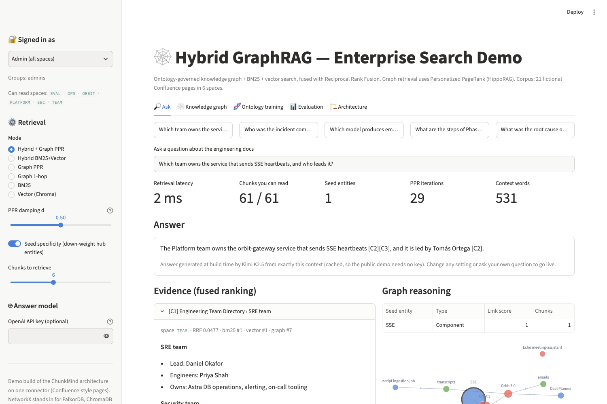
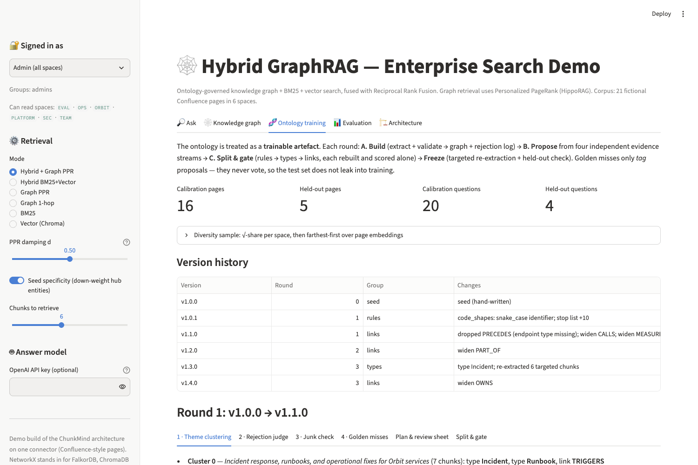
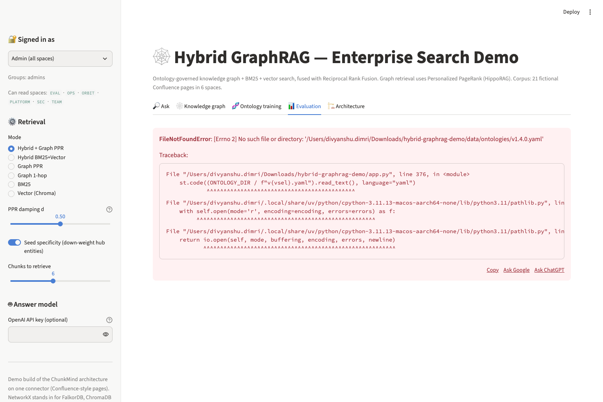

# Hybrid GraphRAG — Enterprise Search Demo

A working, single-connector demo of an enterprise search engine that combines **BM25**, **vector search** and an
**ontology-governed knowledge graph**. The graph is searched with **Personalized PageRank** (the HippoRAG approach),
and the three ranked lists are fused with **Reciprocal Rank Fusion**. The ontology itself is **trained**: proposed
from four evidence streams, ablated per change group, and released only through a multi-metric gate.

**Live demo:** _add your Streamlit Cloud URL here_  ·  runs without any API key

> This is the open demo version of a production design (ChunkMind + Odyn). Production uses Kafka, FalkorDB,
> AstraDB and several connectors. This demo uses one connector (Confluence-style pages) with NetworkX,
> ChromaDB and a batch build, so it runs anywhere for free. The corpus is **21 fictional pages** about a
> fictional company, so nothing here is real company data.



## What it demonstrates

| Capability | Where |
|---|---|
| Structure-aware chunking (headings, code blocks never split), near-duplicate removal | `hybridrag/ingest.py` |
| Tiered extraction: Tier 0 regex/metadata (Jira keys), Tier 1 LLM guided by the ontology | `hybridrag/extract.py` |
| Ontology validator + **rejection log** (unknown type, unknown verb, bad endpoints, name rules) | `hybridrag/extract.py`, `hybridrag/ontology.py` |
| **Ontology training loop**: theme clustering, rejection judge, two-model junk audit, golden-miss diagnosis → consolidation → split & gate → targeted re-extraction → held-out check | `hybridrag/learning.py`, `build.py` |
| Knowledge graph on NetworkX, HippoRAG 2 layout (entity + passage nodes, synonym edges) | `hybridrag/graph.py` |
| **Personalized PageRank** with seed specificity and link trust; verified equal to `networkx.pagerank` | `hybridrag/graph.py`, `tests/` |
| BM25 (`rank_bm25`) + ChromaDB cosine ANN (local MiniLM ONNX embeddings) + RRF | `hybridrag/retrieve.py` |
| **Permission-aware retrieval**: chunks filtered by JWT groups *before* ranking; graph facts shown only if the user can open a source chunk | `hybridrag/retrieve.py`, `hybridrag/graph.py` |
| Context refinement: section breadcrumbs, token-budget trimmer that keeps code blocks whole | `hybridrag/retrieve.py` |
| Answers: streamed GPT-4o-mini with citations (your key), or a cited extractive answer | `hybridrag/answer.py` |
| Evaluation: golden set, Recall/nDCG/MRR/Hit@k, by question type, ablations, damping sweep | `hybridrag/evaluate.py` |

## How the ontology is trained

```
Step A  Build      extract under ontology vN → validator → accepted graph + rejection log
Step B  Propose    1 theme clustering     raw calibration chunks → LLM discovers missing types / links
                   2 rejection judge      recurring rejected patterns (≥3 chunks) → extend | wrong verb | junk
                   3 junk check           shape rules (≥2 names) + two-model audit (Qwen flags, Kimi confirms)
                   4 golden misses        not_extracted / not_linked / ranked_low → tags only, never votes
                   → consolidation (one LLM call merges synonyms) → support gate → plan + review sheet
Step C  Split      rules (patch) → types (minor, with targeted re-extraction) → links (minor)
        Gate       each group rebuilt and scored alone; ships only if
                   junk does not rise · schema-gap share ≤ old + 2 pts · Recall@5 and nDCG@5 drop ≤ 0.02
Freeze             held-out check: no held-out question may lose evidence it had
```

Safeguards that came from real failures during the build:
- the audit once flagged the real service `orbit-gateway` as junk, so a well-connected entity (graph degree ≥ 2) now goes to human review instead of the automatic stop list;
- types whose real names are identifiers (`DataStore`, `Metric`, `APIEndpoint`, `JiraIssue`) are exempt from code-shape rules.

**What happened in this build (3 rounds, v1.0.0 → v1.3.0):**
- **v1.0.1 rules:** a snake_case rule and a 7-name stop list. Code-like entity names fell from 38 to 17.
- **types rolled back:** the first proposed types reduced calibration Recall@5 (0.400 → 0.350), so the gate refused them.
- **v1.1.0 links:** CALLS and MEASURES widened. The schema-gap share fell from 0.090 to 0.067.
- **v1.2.0 types:** `Incident` and `PipelineStage` were added, with 7 targeted chunks re-extracted.
- **v1.3.0 links:** PART_OF widened. The schema-gap share is now 0.057.
- **Round 3** found nothing more to change, so the loop converged.



## Results (24 golden questions, k = 5)

| Retriever | Recall@5 | nDCG@5 | MRR | Hit@3 |
|---|---|---|---|---|
| BM25 | 0.826 | 0.689 | 0.680 | 0.875 |
| Vector (ChromaDB) | 0.750 | 0.610 | 0.636 | 0.708 |
| Graph, 1-hop baseline | 0.486 | 0.337 | 0.335 | 0.417 |
| Graph, PPR | 0.486 | 0.303 | 0.278 | 0.292 |
| Hybrid BM25 + vector | 0.792 | 0.721 | 0.761 | 0.792 |
| **Hybrid + graph PPR** | **0.743** | 0.617 | 0.635 | 0.667 |
| Hybrid + graph PPR, seed ontology | 0.715 | 0.593 | 0.609 | 0.708 |

Recall@5 by question type:

| | fact (13) | process (4) | multi-hop (5) | aggregation (2) |
|---|---|---|---|---|
| Hybrid BM25 + vector | 0.92 | 0.75 | 0.60 | 0.50 |
| Hybrid + graph PPR | 0.77 | **0.83** | **0.70** | 0.50 |

**Reading these numbers honestly**
- On 21 short pages BM25 is very strong; every method is near the ceiling for single-fact questions.
- The graph earns its place on **multi-hop and process questions** (0.60 → 0.70 and 0.75 → 0.83 recall),
  and costs recall on some single-fact lookups. A query router or learned fusion weights would fix that; they are
  deliberately **not** tuned here, because tuning on a 24-question test set would be overfitting.
- Ontology training raised hybrid + graph Recall@5 from 0.715 to 0.743 and cleaned the graph (fewer junk
  entities, fewer schema gaps). The gate is what keeps it honest.
- One question moves Recall@5 by about 0.04, so treat smaller differences as noise.
- PPR costs ≈ 0.4 ms per question; full graph retrieval ≈ 0.5 ms.



## Run it

```bash
python -m venv .venv && source .venv/bin/activate
pip install -r requirements.txt
streamlit run app.py
```

The first start downloads the 80 MB MiniLM ONNX model used by ChromaDB. No API key is needed: the graph,
ontology versions, evaluation and five starter answers are precomputed in `data/build/`. Paste an OpenAI key in
the sidebar to get live generated answers for any question.

**Deploy free:** push to GitHub → [share.streamlit.io](https://share.streamlit.io) → *New app* → pick the repo, `app.py`.

### Rebuild from scratch

```bash
python build.py          # replays every LLM call from data/build/llm_cache (offline, deterministic)
pytest -q                # PPR equals networkx.pagerank; validator is pure; permissions hide restricted facts
```

To re-run the LLM steps (for example after editing the corpus or prompts), point the build at any
OpenAI-compatible endpoint:

```bash
export LLM_BASE_URL=...  LLM_API_KEY=...   # or just OPENAI_API_KEY for OpenAI
python build.py
```

The committed cache was built with **Kimi K2.5** (extraction, discovery, judge, consolidation, junk confirmation)
and **Qwen3-235B** (first junk auditor): the whole build replays from **31 cached LLM calls** (28 Kimi, 3 Qwen). Chunks are batched 6 per extraction call, and all theme
clusters share one discovery call.

## Layout

```
app.py                  Streamlit UI (Ask · Knowledge graph · Ontology training · Evaluation · Architecture)
build.py                offline pipeline: extract → train ontology → freeze → evaluate
hybridrag/
  ingest.py             pages → structure-aware chunks, near-duplicate removal
  ontology.py           ontology model, normalisation, name rules
  extract.py            tiered extraction + validator (rejection log)
  learning.py           ontology training loop and release gate
  graph.py              NetworkX graph, Personalized PageRank, permission-aware facts
  retrieve.py           BM25 + ChromaDB + entity linking + PPR + RRF + context trimming
  answer.py             LLM or extractive cited answers
  evaluate.py           golden-set metrics
  llm.py, embed.py      cached LLM client, local ONNX embeddings
data/corpus/            21 fictional Confluence-style pages in 6 spaces (ORBIT, PLATFORM, EVAL, OPS, SEC, TEAM)
data/golden_set.yaml    24 questions with evidence quotes
data/ontologies/        seed + every released version (v1.0.0 … v1.3.0)
data/build/             cached LLM responses, extractions, learning log, evaluation
```

## Demo vs production

| Production (ChunkMind + Odyn) | This demo |
|---|---|
| Confluence, Jira, GitHub, Notion connectors via Kafka | one Confluence-style connector, batch build |
| FalkorDB | NetworkX |
| AstraDB (BM25 + cosine ANN) | rank_bm25 + ChromaDB |
| GPT-4o over SSE | GPT-4o-mini streaming (visitor's key) or cached / extractive answers |
| AD provisioning, hourly JWT rotation | simulated users and groups in the sidebar |
| Odyn evaluation and analytics | golden-set evaluation tab |
